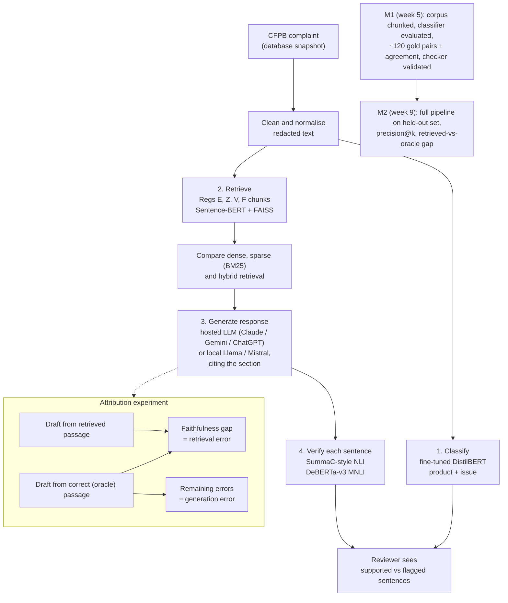
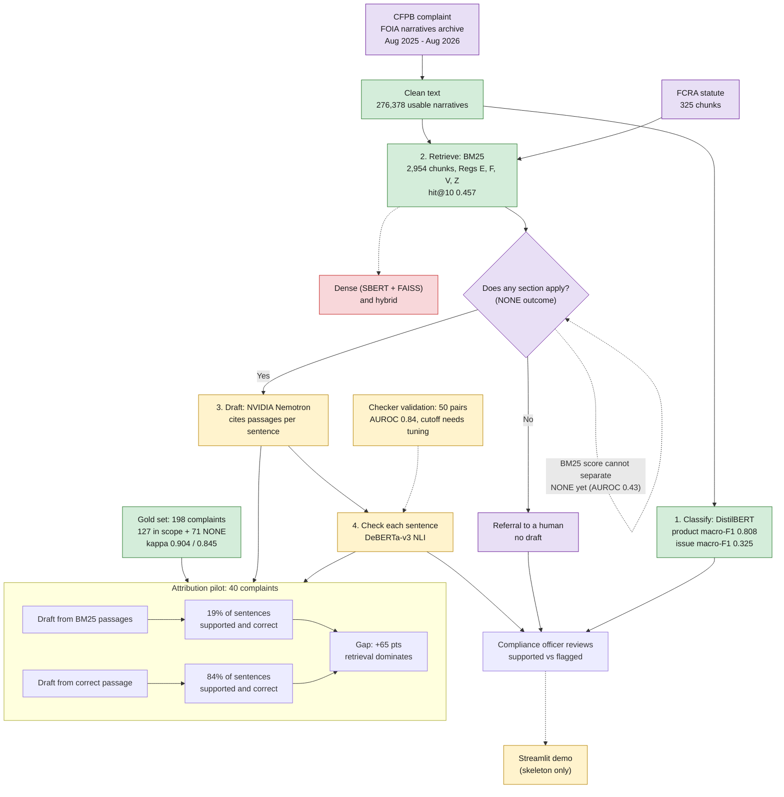

# Regulation-Grounded Triage and Response Drafting for CFPB Consumer Complaints

**CSCI 544 (Applied NLP), Group 36:** Aditya Datar, Ujjwal Puri, Ishani Bhadlikar, Atharva Thorat, Anirudh Joshi, Gagan Shivanna.

This document collects the project-level material for the midterm presentation and report: the goal, data, results, decisions and the reasons behind them, and what changed from the proposal. Code-level details live in the repository. Status as of **2026-10-19**.

---

## 1. Goal

A compliance officer at a bank, lender or credit bureau must work out which federal rule governs each consumer complaint and respond within 15 days (up to 60 for a final response). Our system **assists** that officer; it never replaces them. For each complaint it:

1. **Classifies** the product and issue (fine-tuned DistilBERT).
2. **Retrieves** the governing regulation section.
3. **Drafts** a response that cites the retrieved section (an LLM).
4. **Checks every drafted sentence** against the cited text and flags unsupported ones for the reviewer (sentence-level NLI, following SummaC).

### 1.1 Proposed flow (from the project proposal)

### 1.2 Current flow (status on 2026-10-19)

Green = done and measured. Yellow = built, partly evaluated. Red = not built yet. Purple = added since the proposal.

**What changed between the two flows:**
- **Data source:** the FOIA narratives archive replaced the live database, which stopped publishing narratives.
- **Scope:** the FCRA statute was added next to Regs E, Z, V and F.
- **New outcome:** "no governing section" (NONE), which routes the complaint to a human.
- **LLM:** NVIDIA Nemotron was chosen.
- **Not yet built:** dense and hybrid retrieval. Only the BM25 baseline exists.
- **Not yet working:** detecting when no section applies; the BM25 score cannot do it.
- **Not finished:** the checker's cutoff needs tuning (or an LLM judge), and the gap is measured on a 40-complaint pilot, not the full held-out set.

**Core contribution, the attribution experiment.** Each complaint is drafted twice: once from the passage our retriever found, and once from the correct ("oracle") passage chosen by annotators. The faithfulness gap between the two runs is the error caused by **retrieval**; the unfaithfulness that remains with the correct passage is caused by **generation**. Earlier evaluations of legal AI tools (Magesh et al.) score the whole system at once and cannot say which stage failed. The answer tells a practitioner where to invest: better retrieval (chunking, hybrid search) or safer generation (constrained decoding, verification gating).

**Motivation figure (with its caveat).** CFPB complaints rose from about 1.6M (2023) to 3.2M (2024) to 6.6M (2025), per the CFPB's 2025 Consumer Response Annual Report. The CFPB attributes part of this growth to credit repair organizations and automated submissions, so state that alongside the figure.

---

## 2. Data

### 2.1 Complaints

**Decision: use the CFPB's FOIA narratives archive, not the live database.** On 2026-08-14 the CFPB stopped publishing complaint narratives; the current database and bulk CSV no longer contain the narrative text our pipeline needs. Previously published narratives remain in the CFPB's FOIA Reading Room archive.

- **Source:** CFPB Consumer Complaint Database narratives archive (FOIA Reading Room), exports 12 to 21, downloaded 2026-10-07.
- **Window:** complaints received **2025-08-14 to 2026-08-14**: one full year, ending on the last day narratives exist.

| Step | Count |
|---|---:|
| Complaints received in the window (duplicates removed) | 6,809,200 |
| With a consumer narrative (consumers opt in to publication) | 469,659 (6.9%) |
| Usable after cleaning (≥ 20 words, mostly unredacted, exact duplicates removed) | 276,378 |
| Classifier train / validation / test | 111,527 / 14,022 / 13,905 |

- **Cleaning:** the CFPB masks personal details (`XXXX`, masked dates, braced amounts). We normalise every mask format to placeholders such as `[DATE]` and `[REDACTED]`.
- **Duplicates:** consumers often file the same text against several companies (for example all three credit bureaus). Exact duplicates are removed **before** splitting, so a copy cannot sit in both training and test data.
- **Skew:** credit reporting is 90% of all complaints but only 33% of usable narratives. We cap each product at 20,000 complaints before splitting.
- **Narrative length:** median 175 words (IQR 93 to 285).

| Product | All complaints | Usable narratives |
|---|---:|---:|
| Credit reporting | 6,152,294 | 89,993 |
| Debt collection | 332,548 | 55,465 |
| Checking or savings account | 86,182 | 36,606 |
| Credit card | 95,747 | 34,860 |
| Money transfer / virtual currency | 38,283 | 17,602 |
| Mortgage | 31,772 | 13,000 |
| Vehicle loan or lease | 24,594 | 10,275 |
| Payday / title / personal loan | 17,440 | 7,362 |
| Student loan | 19,671 | 6,617 |
| Prepaid card | 6,311 | 2,785 |
| Debt or credit management | 4,358 | 1,813 |

### 2.2 Regulations

- **Source:** eCFR Title 12, fixed at its 2026-10-13 version so every result refers to the same text.
- **Scope:** Regulation E (12 CFR 1005, electronic fund transfers), Z (1026, truth in lending), V (1022, fair credit reporting), F (1006, debt collection), **plus the Fair Credit Reporting Act statute (15 U.S.C. 1681 to 1681x)** (see decision D3).
- **Chunking by legal structure,** not fixed windows: one chunk per paragraph, split further only when a paragraph is too long for the embedding model. Each chunk keeps its section and paragraph label, so retrieval can be scored by section.
- **Retrieval corpus: 2,954 chunks** (2,629 regulation text + 325 FCRA). A second corpus of 4,319 chunks, which also includes the official interpretations and appendices, is kept for a chunking comparison.

---

## 3. Gold annotation set

**Purpose:** ground truth for retrieval, and the "correct passage" for the attribution experiment.

| | Value |
|---|---|
| Complaints labelled | **198** |
| With a governing section ("in scope") | **127**: Reg E 29, Reg F 30, Reg Z 27, FCRA 36, Reg V 5 |
| No governing section in our corpus ("NONE") | **71** |
| Labels | regulation, section, paragraph, and a verbatim supporting quote |

**Process.**
- A written rubric, then **two LLM annotators from different model families** (Claude and ChatGPT) labelled every complaint independently, under the same rubric. Every quoted passage was checked automatically to appear verbatim in the cited section.
- **A team member** resolved all disagreements, and re-checked a random sample of 20 agreed items.
- Report these as *silver* labels (LLM-produced, human-reviewed).

| Agreement between the two annotators | Agreement | Cohen's kappa |
|---|---:|---:|
| Regulation level | 92.4% | **0.904** |
| Section level | 86.9% | **0.845** |
| In scope vs NONE | 95.5% | 0.898 |

- 26 disagreements resolved by the team member: 12 sided with Claude, 13 with ChatGPT, 1 with neither. The random check of 20 agreed items found **20/20 correct**.
- Annotator confidence was informative: section agreement was 66.7%, 89.9% and 98.1% at confidence 1, 2 and 3.
- Typical disagreements: credit-report disputes mixed with identity theft (two possible FCRA sections), vague credit-card interest complaints, and furnisher cases on the boundary between the FCRA, Reg V and Reg F.

---

## 4. Results so far

### 4.1 Classifier (DistilBERT, test set of 13,905 complaints)

| Task | Macro-F1 | Accuracy | Notes |
|---|---:|---:|---|
| **Product** (11 classes) | **0.808** | 0.843 | weighted F1 0.842 |
| **Issue** (84 issues present in test) | **0.325** | 0.581 | |
| Issue, frequent issues only (39 issues with ≥ 100 test examples, 91.7% of complaints) | **0.538** | | |
| Issue prediction consistent with the predicted product | 0.857 | | |

**Reporting rule (decided before writing up):** the all-issue number is always shown next to the frequent-issue number, and the ≥ 100 cutoff was fixed in advance. Rare issues are scored on the full test set, not dropped, because dropping them hides false positives and inflates the score.

### 4.2 Retrieval: BM25 baseline (127 in-scope complaints, scored by section)

| Corpus | hit@1 | hit@5 | hit@10 | MRR |
|---|---:|---:|---:|---:|
| Regulations + FCRA (2,954 chunks) | 0.079 | 0.315 | 0.457 | 0.196 |
| Regulations only (2,629 chunks) | 0.055 | 0.220 | 0.339 | 0.144 |

- recall@k equals hit@k (one gold section per complaint); precision@k = hit@k / k.
- hit@10 by regulation (with FCRA): E 0.28, F 0.53, Z 0.33, FCRA 0.61, V 0.60 (only 5 items).
- **Findings:**
  1. Word matching struggles: complaints are written in everyday language, regulations in legal language. BM25 is the weak baseline ("sparse floor") the proposal planned; dense and hybrid retrieval come next.
  2. Adding the FCRA helps overall but pushes correct sections of other regulations down the ranking (non-FCRA hit@10 falls from 0.473 to 0.396; Reg E from 0.45 to 0.28).
  3. **The BM25 score cannot tell whether a regulation applies at all** (AUROC 0.43, at or below chance). Complaints with no governing section are longer (median 228 words vs 164), and long texts score high regardless.

### 4.3 Attribution pilot: retrieved vs correct passage

**Setup.**
- 41 in-scope complaints from the gold set: 9 each for Regs E, F and Z and the FCRA, plus all 5 Reg V items.
- Each complaint was drafted twice by Nemotron with the same prompt: once from BM25's top 5 passages ("retrieved") and once from the gold section's passages ("correct").
- Every sentence was scored by the DeBERTa-v3 checker against the passages it cites.
- 1 of 82 drafts failed: the model used its whole output budget on internal reasoning and returned no answer. It is reported as a failure, and the 40 complaints with both drafts are compared.

**Two measures, because they answer different questions:**
- **Supported:** the sentence is backed by the passage it was given. This measures *faithfulness to the context*, the definition used by RAGAS.
- **Supported and correct:** backed by a passage from the *correct* section. This measures *legal correctness*, closer to Magesh et al.'s definition, where faithfully repeating the wrong authority still counts as a hallucination.

Rates are averaged per complaint (40 complaints). 95% confidence intervals come from a paired bootstrap over complaints.

| Measure | Retrieved (BM25) | Correct passage | Gap (correct − retrieved) | 95% CI |
|---|---:|---:|---:|---|
| Correct section among the passages given | 35% | 100% | | |
| **Sentences supported** | 77.7% | 83.8% | +6.1 pts | −6.6 to +19.7 |
| **Sentences supported and correct** | **19.0%** | **83.8%** | **+64.9 pts** | **+52.3 to +76.8** |

| Regulation (n) | Supported: retrieved / correct | Supported and correct: retrieved / correct |
|---|---|---|
| E (9) | 64% / 98% | 8% / 98% |
| F (9) | 93% / 98% | 31% / 98% |
| FCRA (9) | 76% / 90% | 34% / 90% |
| V (5) | 80% / 90% | 20% / 90% |
| Z (8) | 77% / 42% | 0% / 42% |

**Cross-check with human labels.** The 50 checker-validation pairs (Sec. 4.4) are a random sample of these same pilot sentences, now with human-adjudicated labels. They give an estimate that does not depend on the checker:

| Human labels, 25 sentences per condition | Retrieved (BM25) | Correct passage |
|---|---:|---:|
| Supported | 36% (9/25) | 68% (17/25) |
| Supported and correct | 16% (4/25) | 68% (17/25) |

**Findings.**
1. **Retrieval is the dominant source of error.** With the correct passage, most sentences are supported and correct; with BM25's passages, few are. The gap is 65 points by the checker (CI +52 to +77) and 52 points by the human labels. Both measurements agree on the direction and the rough size.
2. **Faithfulness alone understates retrieval errors.** By human labels, "supported by the given passage" shows a 32-point gap, while "supported and correct" shows 52. The model often restates the wrong section it was handed faithfully, which counts as faithful but is legally wrong. This is the tension between RAGAS-style faithfulness and the legal definition of Magesh et al. noted in our related work. (At its default cutoff the checker made the two conditions look nearly equal, 77.7% vs 83.8%; the human labels show that was partly the checker being too lenient, see Sec. 4.4.)
3. **Generation error is substantial even with the correct passage:** about 16% of sentences unsupported by the checker, 32% by the human labels.
4. **Reg Z is the exception.** Correct-passage drafts score only 42% supported by the checker. Many Reg Z sentences apply the rule to the complaint's facts (for example, "these charges constitute a billing error under 1026.13(a)(1)"), which the passage alone cannot confirm.

**Caveats.** This is a pilot: 40 complaints, one retriever (BM25, the weak baseline), and a checker whose default cutoff is too lenient (Sec. 4.4). The human-label estimate rests on 25 sentences per condition. Read the size of the gaps as indicative; the direction is consistent across both measurements.

### 4.4 Checker validation

**Setup.**
- 50 (passage, sentence) pairs sampled at random from the pilot drafts, 25 per condition. Sampling did not use the checker's scores.
- Two annotators from different LLM families (Claude and ChatGPT) labelled each pair blind, under a written rubric.
- A team member resolved the 12 disagreements. Final labels: 26 supported, 24 unsupported.

| Annotator agreement | Value |
|---|---:|
| Agreement | 76.0% |
| Cohen's kappa | 0.54 (moderate) |
| Disagreements | 12, all "supported" (Claude) vs "unsupported" (ChatGPT); resolved 4 / 8 |

The disagreements were all about how strict to be when a sentence leaves out a qualifier of the rule (for example "the consent day counts as day 1", or "only for open-end, not home-secured plans").

**Checker (DeBERTa-v3 NLI) against the final labels:**

| Measure | Value |
|---|---:|
| AUROC (ranking supported above unsupported) | **0.84** |
| At the default cutoff 0.5: balanced accuracy / kappa | 0.63 / 0.26 |
| At the default cutoff 0.5: share of unsupported sentences caught | **25%** |
| With a strict cutoff chosen by 5-fold cross-validation: balanced accuracy / kappa | **0.78 / 0.55** |
| With that strict cutoff: share of unsupported sentences caught | 75% |

**Findings.**
- The checker **ranks** sentences well (AUROC 0.84), but at the default cutoff it is far too lenient: it misses three quarters of unsupported sentences.
- Its scores are squeezed close to 1: the median supported sentence scores 0.998, the median unsupported one 0.95. A useful cutoff sits near 0.99, where small changes matter a lot.
- With a cross-validated strict cutoff, agreement with the human labels (kappa 0.55) is about the same as the agreement between the two annotators (0.54). So the checker is roughly as reliable as a second annotator, but only once the cutoff is tuned.
- The checker struggles most with omitted qualifiers and with sentences that apply a rule to the complaint's facts. These are also exactly the cases where the two annotators disagreed.

**Decision (the proposal's risk plan).** The checker works for ranking and flagging, not for absolute "% supported" numbers at its default setting. Next: (1) use a tuned cutoff on a larger labelled set, and (2) benchmark an LLM-based judge on the same 50 pairs, keeping whichever agrees better with the human labels.

---

## 5. Project decisions and why

| # | Decision | Why |
|---|---|---|
| D1 | CFPB pipeline chosen over two alternatives | A voice customer-service agent had no public dataset pairing call audio with policy and escalation labels. A context-compression study lacked a convincing motivation. CFPB data is public, the need is real (legal deadlines, rising volume), and it supports a genuine evaluation contribution. |
| D2 | FOIA narratives archive, one year ending 2026-08-14 | The live database stopped carrying narratives on 2026-08-14. One full year ending on the last available day gives the most recent complete data. |
| D3 | **FCRA statute added to the scope** | In the first 120 labelled complaints, 64% had no governing section, and 36 of them were governed by the FCRA itself (credit-bureau reinvestigations, identity-theft blocks, permissible purpose, furnisher duties). Regulation V does not cover these, and credit reporting is the largest product. Without the FCRA, the system could not handle its most common complaint type. |
| D4 | **"No governing section" (NONE) is a valid outcome** | About a third of real complaints fall under law outside our corpus (federal student loans, mortgage servicing rules, state law, scams the consumer authorised). A compliance assistant must say "route to a human" rather than cite a wrong section. Every stage may output NONE; the system drafts a referral instead of a cited response. |
| D5 | Gold set stratified across regulations, not natural frequency | At natural frequency, credit reporting dominates and Regs E, Z and F would have too few cases to evaluate. A top-up of 78 complaints brought Regs E, F, Z and the FCRA to about 30 in-scope items each. Reg V stays at 5, because few complaints fall under its narrow rules (most credit-reporting complaints are FCRA matters). |
| D6 | LLM annotators with human review | Two annotators from different model families, a shared rubric, automatic quote checks, human resolution of every disagreement and a human spot check. This makes annotation feasible for a team without legal training while still measuring agreement. |
| D7 | Retrieval scored by section | Annotators agree far better on the section than on the exact paragraph, and a reviewer reads the whole section anyway. |
| D8 | Classifier: DistilBERT, macro-F1, fixed issue-reporting rule | DistilBERT fits a single free GPU session. Classes are imbalanced, so macro-F1 is the headline. The issue-reporting rule (Sec. 4.1) was fixed before writing up to avoid choosing a flattering cutoff. |
| D9 | Stable data splits | Each complaint's split is fixed by a hash of its id, so fixing a data bug or adding rows never reshuffles the test set. |
| D10 | One fixed regulation snapshot (eCFR 2026-10-13) | Regulations change; every result and every gold quote must refer to the same text. |
| D11 | **Target LLM: NVIDIA Nemotron** (`nemotron-3-super-120b-a12b`), temperature 0, fixed for all reported numbers | Hosted, fast, and available to the team. Switching models mid-project would invalidate collected numbers. Every response is cached, so reruns cost nothing and results are reproducible. |
| D12 | Checker: off-the-shelf DeBERTa-v3 NLI, validated against labelled pairs | Follows SummaC. If it agrees poorly with the labels, we switch to an LLM-based judge benchmarked the same way (the proposal's risk plan). |
| D13 | Attribution experiment uses in-scope complaints only | Complaints with no governing section have no correct passage to compare against. |
| D14 | Retrieval corpus: the 2,954-chunk regulation + FCRA set by default | It is sized for the chosen embedding model. The larger corpus with interpretations is kept for a chunking comparison, decided by measurement. |

---

## 6. Changes from the proposal (explain these in the report)

| Proposal said | What we did | Why |
|---|---|---|
| A snapshot of the CFPB database | The FOIA narratives archive | Narratives were withdrawn from the live database on 2026-08-14 (D2). |
| Four regulations: E, Z, V, F | E, Z, V, F **+ the FCRA statute** | D3 |
| ~120 pairs reflecting the real distribution | 198 complaints, stratified across regulations, including 71 NONE | D4, D5 |
| Annotation by team members | Two LLM annotators + human resolution and spot check | D6 |
| A hosted LLM such as Claude, Gemini or ChatGPT | NVIDIA Nemotron (hosted) | D11 |
| Milestone 2: full pipeline on a held-out set with the faithfulness gap | Full pipeline running; the gap measured on a **41-complaint pilot** | The full evaluation follows in weeks 10 to 14. |

---

## 7. Milestone status

| Milestone item | Status |
|---|---|
| **M1:** regulation corpus chunked | ✅ Done |
| **M1:** classifier fine-tuned and evaluated | ✅ Done (Sec. 4.1) |
| **M1:** ~120 annotated pairs with agreement | ✅ Done: 198 complaints, kappa 0.904 / 0.845 (Sec. 3) |
| **M1:** checker validated against labelled pairs | ✅ Done: 50 labelled pairs, AUROC 0.84; default cutoff too lenient, tuned cutoff kappa 0.55 (Sec. 4.4) |
| **M2:** retrieval precision@k | ✅ BM25 (Sec. 4.2); dense and hybrid next |
| **M2:** full pipeline running end to end | ✅ All four stages with real models |
| **M2:** retrieved-vs-correct faithfulness gap | ✅ Pilot on 40 complaints: +64.9 pts for supported-and-correct sentences (Sec. 4.3) |

## 8. Next steps (weeks 10 to 14)

1. Dense retrieval (Sentence-BERT + FAISS) and a dense + sparse hybrid; compare with BM25.
2. A better "does any regulation apply?" signal than the raw retrieval score.
3. The full attribution experiment on more complaints, with the validated checker.
4. Ablations: chunking strategy (with vs without interpretations) and retriever type.
5. Error analysis using the RAG failure categories of Barnett et al. (2024).
6. Streamlit demo showing category, retrieved passage with citation, draft response, and a per-sentence supported/flagged report.
7. Final report.

## 9. Key references

- Magesh et al. (2024/2025), "Hallucination-free? Assessing the reliability of leading AI legal research tools." arXiv 2405.20362.
- Es et al. (2024), RAGAS, EACL System Demonstrations.
- Laban et al. (2022), SummaC, TACL.
- Dahl et al. (2024), "Large legal fictions," Journal of Legal Analysis.
- Barnett et al. (2024), "Seven failure points when engineering a RAG system," CAIN.
- Pipitone and Alami (2024), LegalBench-RAG. arXiv 2408.10343.
- CFPB (2026), Consumer Response Annual Report 2025.
