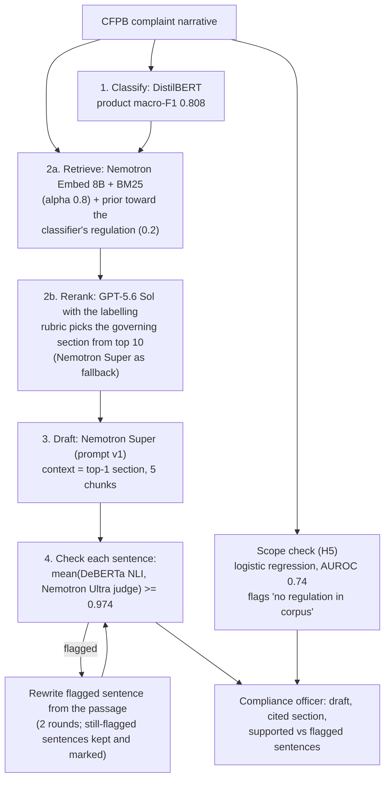
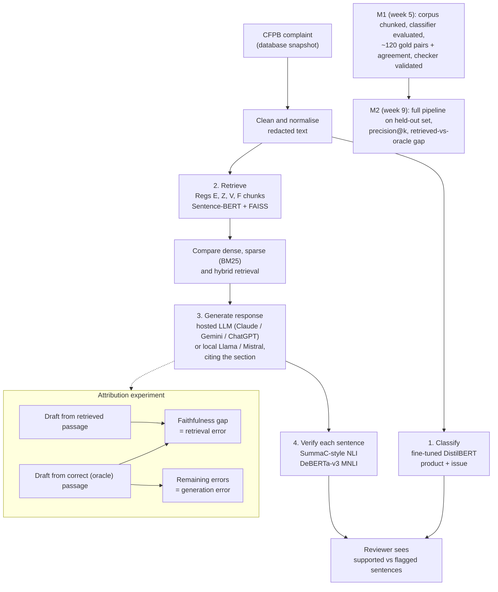
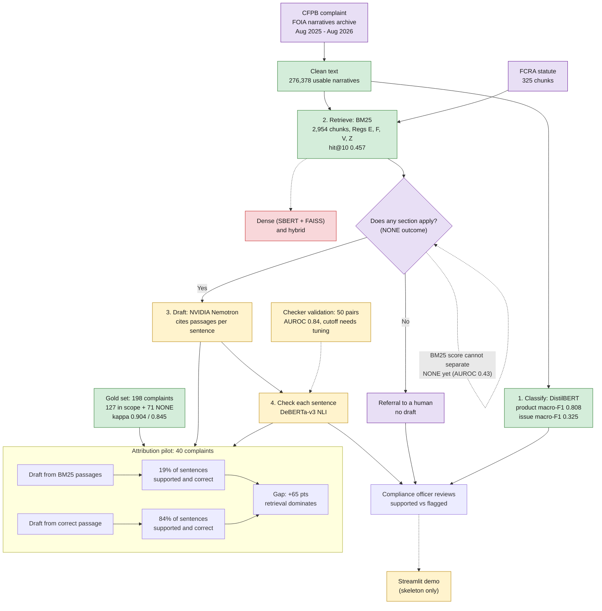

# Regulation-Grounded Triage and Response Drafting for CFPB Consumer Complaints

**CSCI 544 (Applied NLP), Group 36:** Aditya Datar, Ujjwal Puri, Ishani Bhadlikar, Atharva Thorat, Anirudh Joshi, Gagan Shivanna.

This document collects the project-level material: the goal, data, results, decisions and the reasons behind them, and what changed along the way. **Status as of 2026-11-24 (all final experiments done).**

- **Part I (read first): final results.** These supersede every midterm number.
- **Part II: the midterm record (2026-10-19),** kept unchanged as history. Its numbers come from an earlier pipeline and a retired generator, so do not compare them directly with Part I.

**Where things live.**
- Code, results and logs: branch `final-experiments` (commit `552432b`).
  - `results/final_results.json`: every headline number, with its source file and 95% CI.
  - `docs/EXPERIMENT_LOG.md`: experiments E1 to E17, each with its question, setup, result and caveats.
  - `CLAUDE_PROGRESS.md`: narrative history.
- Officer web app: `app/` on `final-experiments`.
- Final presentation: `final_presentation/` on this branch (`SLIDES.md` holds the slide text and speaker notes).

---

# Part I: Final results (2026-11-24)

## F1. The finalized pipeline

- **Model IDs:**
  - drafter `nvidia/nemotron-3.5-super-vl-120b-a12b`, temperature 0;
  - judge `nvidia/nemotron-3-ultra-550b-a55b`;
  - NLI `MoritzLaurer/DeBERTa-v3-large-mnli-fever-anli-ling-wanli`;
  - reranker `codex:gpt-5.6-sol`.
- **Generator change:** NVIDIA retired the original `nemotron-3-super-120b-a12b` on 2026-10-03, so every final draft uses the 3.5 Super model. Midterm pilot numbers are not comparable.
- **The app runs this exact pipeline.** The GPT reranker uses the Codex login of whichever machine runs the app, so the report must disclose that the best configuration depends on a hosted GPT model.

## F2. Evaluation setup

- **Gold set:** 198 complaints: 127 in scope and 71 with no governing section in the corpus (NONE). Kappa 0.904 at regulation level, 0.845 at section level, 0.898 for scope (Part II, Sec. 3).
- **Split:**
  - The 127 in-scope complaints are split by hash into **dev (62)** and **held-out (65)**.
  - Every design choice was made on dev. Held-out was run once per configuration, under rules written in `EXPERIMENT_LOG.md` before the run.
- **Checker labels:** 150 (passage, sentence) pairs, two sets:
  - Set 1: 50 pairs, adjudicated by the team.
  - Set 2: 100 pairs, AI-adjudicated and accepted by Atharva. This makes them **silver labels**, not human-validated.
  - Checker cutoffs are chosen on set 1 and tested on set 2.
- **FINAL ACCURACY** (the headline metric): the share of draft sentences that meet both conditions:
  1. The checker says the passage supports the sentence.
  2. The sentence cites the gold section, or a section in that complaint's frozen cluster of accepted equivalents. There are 55 clusters, LLM-built and LLM-reviewed, so they are silver labels; the protocol is in `docs/CLUSTER_SCORING_PROTOCOL.md`.

  A sentence that is supported but cites the wrong law counts as a failure. This is Magesh et al.'s legal definition of a hallucination, not RAGAS faithfulness.
- **Acceptable draft:** at least one correct cited sentence, and at least 50% of the draft's sentences OK.
- **Statistics:** 95% bootstrap CIs; comparisons are paired over complaints.

## F3. Results by stage (held-out)

### Classifier (unchanged since the midterm; test set of 13,905)
- **Product:** macro-F1 0.808, accuracy 0.843.
- **Issue:** macro-F1 0.325 over all 84 issues, and 0.538 over the 39 issues with at least 100 test examples.

### Retrieval (65 held-out complaints, section-level, with FCRA)

| Retriever | top-1 | hit@5 | hit@10 | MRR |
|---|---:|---:|---:|---:|
| BM25 (midterm baseline) | 0.061 | 0.246 | 0.339 | 0.164 |
| Dense MPNet | 0.200 | 0.615 | 0.831 | 0.393 |
| Hybrid MPNet + BM25 (H1 winner) | 0.200 | 0.661 | 0.800 | 0.402 |
| Hybrid + regulation prior | 0.354 | 0.769 | 0.785 | 0.505 |
| Nemotron Embed 8B hybrid + prior | 0.338 | 0.738 | 0.908 | 0.515 |
| + LLM rerank (Nemotron Lightning) | 0.538 | 0.877 | 0.908 | 0.662 |
| **+ GPT-5.6 Sol rerank with rubric (final)** | **0.769 [0.662, 0.862]** | n/a | n/a | n/a |

- **Gains:** hybrid beats BM25 on hit@5 by +0.415 [0.292, 0.538]. The LLM rerank beats the hybrid by +0.215 [0.108, 0.323].
- The GPT reranker picks a single section, so only top-1 applies to it. With the same rubric, Nemotron Super reaches 0.631 [0.508, 0.754].
- BGE and E5, dense and hybrid, were also tested; both are below MPNet (`results/final_results.json` → `H1_retrieval`).
- **Chunking ablation:** structure-aware chunks (`struct1400`, the default) beat fixed 200-word windows. Hybrid hit@5 for fixed windows is −0.154 [−0.246, −0.077]; dense is −0.169 [−0.262, −0.077]. These were measured on the regulations-only corpus (`results/ablation_chunking.json`).

### Checker (100 set-2 pairs; cutoff chosen on set 1)

| Checker | Balanced accuracy |
|---|---:|
| DeBERTa NLI, cutoff 0.5 (midterm) | 0.607 |
| DeBERTa NLI, tuned cutoff (SummaC-style) | 0.699 |
| Nemotron Ultra judge alone | 0.753 |
| Bespoke-MiniCheck-7B alone / + Ultra | 0.733 / 0.801 |
| **mean(DeBERTa, Ultra), cutoff 0.974 (final)** | **0.829** |

- **Final checker vs tuned NLI: +0.151 [0.068, 0.237].**
- **Negative results** (none of these grounding checkers beats DeBERTa + Ultra on regulation text):
  - FactCG-DeBERTa-L, 0.665
  - MiniCheck-Flan-T5-L, 0.661
  - HHEM-2.1, 0.585
  - AlignScore-L, 0.634
- The GPT-5.6 Sol judge reaches 0.756, but it helped create the labels, so it is used for evaluation only.
- Sources: E12, E15.

### Scope detection (H5: "does any corpus regulation apply?")
- The midterm BM25 score had AUROC 0.43, at or below chance.
- A logistic regression over retrieval-confidence and length features reaches **AUROC 0.740 [0.625, 0.851]** on the 91 report-half complaints.
- At the threshold chosen on dev it gives 22 correct flags and 28 false ones (1.27 false per correct). That is useful as a prompt to the officer, not for abstaining automatically.

## F4. The attribution experiment (core contribution)

Each held-out complaint is drafted twice: once with the passages our retriever found, once with the correct ("oracle") passages. Both runs use the same drafter, checker and rewriting step. Source: E17, `results/final_results.json` → `finalized_pipeline`.

| FINAL ACCURACY | Retrieved | Oracle | Gap (oracle − retrieved), 95% CI |
|---|---:|---:|---|
| Midterm: BM25, DeBERTa at 0.5, all 127 complaints | 0.18 | 0.87 | +0.704 [0.639, 0.766] |
| Final pipeline, no rewriting | 0.444 [0.364, 0.522] | 0.519 [0.446, 0.587] | +0.075 [−0.033, +0.183] |
| **Final pipeline, rewriting flagged sentences** | **0.694 [0.599, 0.782]** | **0.808 [0.745, 0.864]** | **+0.114 [+0.002, +0.228]** |
| Acceptable drafts, with rewriting | 0.754 | 0.892 | |

**Reading.**
- **At the midterm, retrieval caused most of the error (a 70-point gap).** After reranking the gap is 11 points.
- **Generation is now the larger source of error.** With rewriting, about 0.31 of retrieved-run sentences fail. Roughly 0.11 of that is due to retrieval; the other 0.19 remains even with the correct passage, so it is due to generation.
- **Error analysis: which section each retrieved-run sentence cites:**
  - 77% the gold section (tier 1)
  - 4% an accepted equivalent (tier 2)
  - 7% another section of the right law (tier 3)
  - 12% another law (tier 4)

**Ablations.**
- **Rewriting flagged sentences: +0.25** (0.444 → 0.694), the largest single gain.
- **Rewriting driven by DeBERTa flags alone** (E16) reaches only 0.556 [0.471, 0.639]. So the validated checker is what makes rewriting work.
- **Drafter prompt** (E13, E17, dev):
  - Quote-anchored sentences ("restate one provision, keep every condition") add +0.25 with the oracle passage and +0.165 in the full pipeline without rewriting.
  - With rewriting the change is −0.005, so the two fixes overlap.
  - The anchored prompt also makes drafts address the complaint less often, so prompt v1 was kept.
- **A stronger drafter model doesn't help.** GPT-5.6 Sol as drafter scores −0.038 [−0.121, +0.045] against Super (E13). The failure lies in how the prompt anchors sentences to the passage, not in the model.
- **Strictness check (E14).** The ensemble calls 46% of labelled sentences supported, against 49% by the labels, so the metric is not overly harsh. The old 0.5 cutoff passed 3 of every 4 unsupported sentences.

## F5. Limitations (state these in the report)
1. **The same checker drives the rewrites and scores them.** Some of the +0.25 may come from rewrites tuned to satisfy the checker rather than the regulation. Evidence so far:
   - An independent GPT judge agreed that rewrites improved support in an earlier gating run, E10: +0.174 [0.065, 0.283].
   - A human spot-check of 24 rewritten held-out sentences is **pending**. The sheet is `annotation/spotcheck_rewritten_heldout.csv` on `final-experiments`; the key is in `_key.csv` — do not open it before labelling.
2. **Rewriting makes drafts address the complaint less often:** retrieved runs go from 0.477 to 0.338, measured by the Ultra relevance guard.
3. **Small samples:** 65 held-out complaints, so the CIs are wide. Dev numbers ran higher than held-out (for example 0.794 against 0.694).
4. **Silver labels:** 100 of the 150 checker labels are AI-adjudicated, and the equivalence clusters are LLM-built.
5. **The best reranker is a hosted GPT model.**
6. **No head-to-head with professional tools.** Magesh et al. report 65% accuracy for Lexis+ AI on a different task, graded by lawyers. Our 75% acceptable drafts is in the same range, but it is not a comparison. Never claim we beat the professional tools.
7. The drafts assist a compliance officer; they are not legal advice.

## F6. Officer web app
React + FastAPI. The data is in Postgres on Neon, schema `cfpb_app`, or in local SQLite when no database is configured. The app provides:
- an inbox with the 15-day CFPB deadline countdown;
- triage, the scope check and the retrieved passages, linked to the official text;
- the draft, with each sentence marked supported or flagged;
- officer editing that re-checks every sentence;
- approve or refer, where approving a draft with flagged sentences needs a written justification;
- a full audit history.

See `app/README.md` on `final-experiments`. This replaced the planned Streamlit demo.

## F7. Midterm plan vs what was done

| Midterm next step (Part II, Sec. 8) | Final status |
|---|---|
| Dense (SBERT + FAISS) and hybrid retrieval vs BM25 | ✅ MPNet, BGE and E5, dense and hybrid; then a regulation prior, Nemotron Embed 8B and an LLM rerank (F3) |
| A better "does any regulation apply?" signal | ✅ AUROC 0.74, up from 0.43 (F3) |
| Full attribution experiment with the validated checker | ✅ All 127 complaints, then the matched held-out run (F4) |
| Ablations: chunking and retriever type | ✅ Chunking (F3), retriever type (F3), plus checker, prompt, model and rewriting ablations (F4) |
| Error analysis with Barnett et al.'s categories | 🔄 Replaced by a section-tier analysis (F4) and the E13 causal ablation of drafter failures |
| Streamlit demo | 🔄 Replaced by the officer web app (F6) |
| Final report | ⏳ In progress (`docs/main.tex` on `final-experiments`) |

## F8. Decisions since the midterm, and why

| # | Decision | Why |
|---|---|---|
| D15 | Generator moved to `nemotron-3.5-super-vl-120b-a12b` | NVIDIA retired the frozen model on 2026-10-03. Every final number uses the new model. |
| D16 | Checker replaced: mean(DeBERTa, Ultra) at 0.974 | Tuned NLI alone reached 0.70 balanced accuracy on held-out labels. The ensemble reached 0.83, a significant +0.15, and beat every other checker and combination tested (E12, E15). This is the proposal's risk plan: switch to an LLM judge if NLI fails. |
| D17 | Cluster-based scoring for FINAL ACCURACY | Several sections can govern one complaint, so single-gold scoring was too strict. The clusters were frozen (SHA-256 recorded) before the final runs. |
| D18 | Regulation prior and LLM reranker | The hybrid got the right section into the top 5 but rarely ranked it first. Reranking took top-1 from 0.20 to 0.54. |
| D19 | GPT-5.6 Sol as the final reranker (Aditya's call) | Chosen on dev (0.839 vs 0.774 for Super); held-out confirms it (0.769 vs 0.631). |
| D20 | Rewrite flagged sentences (2 rounds, keep and mark the rest) | Once retrieval improved, generation dominated the error. Rewriting gave the largest gain, and the ensemble drives it in both the app and the evaluation. |
| D21 | Prompt v1 kept | The anchored prompts fail the relevance guard and add nothing once rewriting is on (E17's pre-registered rule did not fire). |
| D22 | Pre-registered held-out rules | Each held-out run was gated by a rule written in the log before the run, so the results can't be tuned on the test set. |

---

# Part II: Midterm record (2026-10-19)

The sections below are unchanged from the midterm version. Numbers there use BM25, the retired generator and the DeBERTa checker at a lenient cutoff; Part I supersedes them.

## 1. Goal

A compliance officer at a bank, lender or credit bureau must work out which federal rule governs each consumer complaint and respond within 15 days (up to 60 for a final response). Our system **assists** that officer; it never replaces them. For each complaint it:

1. **Classifies** the product and issue (fine-tuned DistilBERT).
2. **Retrieves** the governing regulation section.
3. **Drafts** a response that cites the retrieved section (an LLM).
4. **Checks every drafted sentence** against the cited text and flags unsupported ones for the reviewer (sentence-level NLI, following SummaC).

### 1.1 Proposed flow (from the project proposal)

### 1.2 Current flow (status on 2026-10-19)

Green = done and measured. Yellow = built, partly evaluated. Red = not built yet. Purple = added since the proposal.

**What changed between the two flows:**
- **Data source:** the FOIA narratives archive replaced the live database, which stopped publishing narratives.
- **Scope:** the FCRA statute was added next to Regs E, Z, V and F.
- **New outcome:** "no governing section" (NONE), which routes the complaint to a human.
- **LLM:** NVIDIA Nemotron was chosen.
- **Not yet built:** dense and hybrid retrieval. Only the BM25 baseline exists.
- **Not yet working:** detecting when no section applies; the BM25 score cannot do it.
- **Not finished:** the checker's cutoff needs tuning (or an LLM judge), and the gap is measured on a 40-complaint pilot, not the full held-out set.

**Core contribution, the attribution experiment.** Each complaint is drafted twice: once from the passage our retriever found, and once from the correct ("oracle") passage chosen by annotators. The faithfulness gap between the two runs is the error caused by **retrieval**; the unfaithfulness that remains with the correct passage is caused by **generation**. Earlier evaluations of legal AI tools (Magesh et al.) score the whole system at once and cannot say which stage failed. The answer tells a practitioner where to invest: better retrieval (chunking, hybrid search) or safer generation (constrained decoding, verification gating).

**Motivation figure (with its caveat).** CFPB complaints rose from about 1.6M (2023) to 3.2M (2024) to 6.6M (2025), per the CFPB's 2025 Consumer Response Annual Report. The CFPB attributes part of this growth to credit repair organizations and automated submissions, so state that alongside the figure.

---

## 2. Data

### 2.1 Complaints

**Decision: use the CFPB's FOIA narratives archive, not the live database.** On 2026-08-14 the CFPB stopped publishing complaint narratives; the current database and bulk CSV no longer contain the narrative text our pipeline needs. Previously published narratives remain in the CFPB's FOIA Reading Room archive.

- **Source:** CFPB Consumer Complaint Database narratives archive (FOIA Reading Room), exports 12 to 21, downloaded 2026-10-07.
- **Window:** complaints received **2025-08-14 to 2026-08-14**: one full year, ending on the last day narratives exist.

| Step | Count |
|---|---:|
| Complaints received in the window (duplicates removed) | 6,809,200 |
| With a consumer narrative (consumers opt in to publication) | 469,659 (6.9%) |
| Usable after cleaning (≥ 20 words, mostly unredacted, exact duplicates removed) | 276,378 |
| Classifier train / validation / test | 111,527 / 14,022 / 13,905 |

- **Cleaning:** the CFPB masks personal details (`XXXX`, masked dates, braced amounts). We normalise every mask format to placeholders such as `[DATE]` and `[REDACTED]`.
- **Duplicates:** consumers often file the same text against several companies (for example all three credit bureaus). Exact duplicates are removed **before** splitting, so a copy cannot sit in both training and test data.
- **Skew:** credit reporting is 90% of all complaints but only 33% of usable narratives. We cap each product at 20,000 complaints before splitting.
- **Narrative length:** median 175 words (IQR 93 to 285).

| Product | All complaints | Usable narratives |
|---|---:|---:|
| Credit reporting | 6,152,294 | 89,993 |
| Debt collection | 332,548 | 55,465 |
| Checking or savings account | 86,182 | 36,606 |
| Credit card | 95,747 | 34,860 |
| Money transfer / virtual currency | 38,283 | 17,602 |
| Mortgage | 31,772 | 13,000 |
| Vehicle loan or lease | 24,594 | 10,275 |
| Payday / title / personal loan | 17,440 | 7,362 |
| Student loan | 19,671 | 6,617 |
| Prepaid card | 6,311 | 2,785 |
| Debt or credit management | 4,358 | 1,813 |

### 2.2 Regulations

- **Source:** eCFR Title 12, fixed at its 2026-10-13 version so every result refers to the same text.
- **Scope:** Regulation E (12 CFR 1005, electronic fund transfers), Z (1026, truth in lending), V (1022, fair credit reporting), F (1006, debt collection), **plus the Fair Credit Reporting Act statute (15 U.S.C. 1681 to 1681x)** (see decision D3).
- **Chunking by legal structure,** not fixed windows: one chunk per paragraph, split further only when a paragraph is too long for the embedding model. Each chunk keeps its section and paragraph label, so retrieval can be scored by section.
- **Retrieval corpus: 2,954 chunks** (2,629 regulation text + 325 FCRA). A second corpus of 4,319 chunks, which also includes the official interpretations and appendices, is kept for a chunking comparison.

---

## 3. Gold annotation set

**Purpose:** ground truth for retrieval, and the "correct passage" for the attribution experiment.

| | Value |
|---|---|
| Complaints labelled | **198** |
| With a governing section ("in scope") | **127**: Reg E 29, Reg F 30, Reg Z 27, FCRA 36, Reg V 5 |
| No governing section in our corpus ("NONE") | **71** |
| Labels | regulation, section, paragraph, and a verbatim supporting quote |

**Process.**
- A written rubric, then **two LLM annotators from different model families** (Claude and ChatGPT) labelled every complaint independently, under the same rubric. Every quoted passage was checked automatically to appear verbatim in the cited section.
- **A team member** resolved all disagreements, and re-checked a random sample of 20 agreed items.
- Report these as *silver* labels (LLM-produced, human-reviewed).

| Agreement between the two annotators | Agreement | Cohen's kappa |
|---|---:|---:|
| Regulation level | 92.4% | **0.904** |
| Section level | 86.9% | **0.845** |
| In scope vs NONE | 95.5% | 0.898 |

- 26 disagreements resolved by the team member: 12 sided with Claude, 13 with ChatGPT, 1 with neither. The random check of 20 agreed items found **20/20 correct**.
- Annotator confidence was informative: section agreement was 66.7%, 89.9% and 98.1% at confidence 1, 2 and 3.
- Typical disagreements: credit-report disputes mixed with identity theft (two possible FCRA sections), vague credit-card interest complaints, and furnisher cases on the boundary between the FCRA, Reg V and Reg F.

---

## 4. Results so far

### 4.1 Classifier (DistilBERT, test set of 13,905 complaints)

| Task | Macro-F1 | Accuracy | Notes |
|---|---:|---:|---|
| **Product** (11 classes) | **0.808** | 0.843 | weighted F1 0.842 |
| **Issue** (84 issues present in test) | **0.325** | 0.581 | |
| Issue, frequent issues only (39 issues with ≥ 100 test examples, 91.7% of complaints) | **0.538** | | |
| Issue prediction consistent with the predicted product | 0.857 | | |

**Reporting rule (decided before writing up):** the all-issue number is always shown next to the frequent-issue number, and the ≥ 100 cutoff was fixed in advance. Rare issues are scored on the full test set, not dropped, because dropping them hides false positives and inflates the score.

### 4.2 Retrieval: BM25 baseline (127 in-scope complaints, scored by section)

| Corpus | hit@1 | hit@5 | hit@10 | MRR |
|---|---:|---:|---:|---:|
| Regulations + FCRA (2,954 chunks) | 0.079 | 0.315 | 0.457 | 0.196 |
| Regulations only (2,629 chunks) | 0.055 | 0.220 | 0.339 | 0.144 |

- recall@k equals hit@k (one gold section per complaint); precision@k = hit@k / k.
- hit@10 by regulation (with FCRA): E 0.28, F 0.53, Z 0.33, FCRA 0.61, V 0.60 (only 5 items).
- **Findings:**
  1. Word matching struggles: complaints are written in everyday language, regulations in legal language. BM25 is the weak baseline ("sparse floor") the proposal planned; dense and hybrid retrieval come next.
  2. Adding the FCRA helps overall but pushes correct sections of other regulations down the ranking (non-FCRA hit@10 falls from 0.473 to 0.396; Reg E from 0.45 to 0.28).
  3. **The BM25 score cannot tell whether a regulation applies at all** (AUROC 0.43, at or below chance). Complaints with no governing section are longer (median 228 words vs 164), and long texts score high regardless.

### 4.3 Attribution pilot: retrieved vs correct passage

**Setup.**
- 41 in-scope complaints from the gold set: 9 each for Regs E, F and Z and the FCRA, plus all 5 Reg V items.
- Each complaint was drafted twice by Nemotron with the same prompt: once from BM25's top 5 passages ("retrieved") and once from the gold section's passages ("correct").
- Every sentence was scored by the DeBERTa-v3 checker against the passages it cites.
- 1 of 82 drafts failed: the model used its whole output budget on internal reasoning and returned no answer. It is reported as a failure, and the 40 complaints with both drafts are compared.

**Two measures, because they answer different questions:**
- **Supported:** the sentence is backed by the passage it was given. This measures *faithfulness to the context*, the definition used by RAGAS.
- **Supported and correct:** backed by a passage from the *correct* section. This measures *legal correctness*, closer to Magesh et al.'s definition, where faithfully repeating the wrong authority still counts as a hallucination.

Rates are averaged per complaint (40 complaints). 95% confidence intervals come from a paired bootstrap over complaints.

| Measure | Retrieved (BM25) | Correct passage | Gap (correct − retrieved) | 95% CI |
|---|---:|---:|---:|---|
| Correct section among the passages given | 35% | 100% | | |
| **Sentences supported** | 77.7% | 83.8% | +6.1 pts | −6.6 to +19.7 |
| **Sentences supported and correct** | **19.0%** | **83.8%** | **+64.9 pts** | **+52.3 to +76.8** |

| Regulation (n) | Supported: retrieved / correct | Supported and correct: retrieved / correct |
|---|---|---|
| E (9) | 64% / 98% | 8% / 98% |
| F (9) | 93% / 98% | 31% / 98% |
| FCRA (9) | 76% / 90% | 34% / 90% |
| V (5) | 80% / 90% | 20% / 90% |
| Z (8) | 77% / 42% | 0% / 42% |

**Cross-check with human labels.** The 50 checker-validation pairs (Sec. 4.4) are a random sample of these same pilot sentences, now with human-adjudicated labels. They give an estimate that does not depend on the checker:

| Human labels, 25 sentences per condition | Retrieved (BM25) | Correct passage |
|---|---:|---:|
| Supported | 36% (9/25) | 68% (17/25) |
| Supported and correct | 16% (4/25) | 68% (17/25) |

**Findings.**
1. **Retrieval is the dominant source of error.** With the correct passage, most sentences are supported and correct; with BM25's passages, few are. The gap is 65 points by the checker (CI +52 to +77) and 52 points by the human labels. Both measurements agree on the direction and the rough size.
2. **Faithfulness alone understates retrieval errors.** By human labels, "supported by the given passage" shows a 32-point gap, while "supported and correct" shows 52. The model often restates the wrong section it was handed faithfully, which counts as faithful but is legally wrong. This is the tension between RAGAS-style faithfulness and the legal definition of Magesh et al. noted in our related work. (At its default cutoff the checker made the two conditions look nearly equal, 77.7% vs 83.8%; the human labels show that was partly the checker being too lenient, see Sec. 4.4.)
3. **Generation error is substantial even with the correct passage:** about 16% of sentences unsupported by the checker, 32% by the human labels.
4. **Reg Z is the exception.** Correct-passage drafts score only 42% supported by the checker. Many Reg Z sentences apply the rule to the complaint's facts (for example, "these charges constitute a billing error under 1026.13(a)(1)"), which the passage alone cannot confirm.

**Caveats.** This is a pilot: 40 complaints, one retriever (BM25, the weak baseline), and a checker whose default cutoff is too lenient (Sec. 4.4). The human-label estimate rests on 25 sentences per condition. Read the size of the gaps as indicative; the direction is consistent across both measurements.

### 4.4 Checker validation

**Setup.**
- 50 (passage, sentence) pairs sampled at random from the pilot drafts, 25 per condition. Sampling did not use the checker's scores.
- Two annotators from different LLM families (Claude and ChatGPT) labelled each pair blind, under a written rubric.
- A team member resolved the 12 disagreements. Final labels: 26 supported, 24 unsupported.

| Annotator agreement | Value |
|---|---:|
| Agreement | 76.0% |
| Cohen's kappa | 0.54 (moderate) |
| Disagreements | 12, all "supported" (Claude) vs "unsupported" (ChatGPT); resolved 4 / 8 |

The disagreements were all about how strict to be when a sentence leaves out a qualifier of the rule (for example "the consent day counts as day 1", or "only for open-end, not home-secured plans").

**Checker (DeBERTa-v3 NLI) against the final labels:**

| Measure | Value |
|---|---:|
| AUROC (ranking supported above unsupported) | **0.84** |
| At the default cutoff 0.5: balanced accuracy / kappa | 0.63 / 0.26 |
| At the default cutoff 0.5: share of unsupported sentences caught | **25%** |
| With a strict cutoff chosen by 5-fold cross-validation: balanced accuracy / kappa | **0.78 / 0.55** |
| With that strict cutoff: share of unsupported sentences caught | 75% |

**Findings.**
- The checker **ranks** sentences well (AUROC 0.84), but at the default cutoff it is far too lenient: it misses three quarters of unsupported sentences.
- Its scores are squeezed close to 1: the median supported sentence scores 0.998, the median unsupported one 0.95. A useful cutoff sits near 0.99, where small changes matter a lot.
- With a cross-validated strict cutoff, agreement with the human labels (kappa 0.55) is about the same as the agreement between the two annotators (0.54). So the checker is roughly as reliable as a second annotator, but only once the cutoff is tuned.
- The checker struggles most with omitted qualifiers and with sentences that apply a rule to the complaint's facts. These are also exactly the cases where the two annotators disagreed.

**Decision (the proposal's risk plan).** The checker works for ranking and flagging, not for absolute "% supported" numbers at its default setting. Next: (1) use a tuned cutoff on a larger labelled set, and (2) benchmark an LLM-based judge on the same 50 pairs, keeping whichever agrees better with the human labels.

---

## 5. Project decisions and why

| # | Decision | Why |
|---|---|---|
| D1 | CFPB pipeline chosen over two alternatives | A voice customer-service agent had no public dataset pairing call audio with policy and escalation labels. A context-compression study lacked a convincing motivation. CFPB data is public, the need is real (legal deadlines, rising volume), and it supports a genuine evaluation contribution. |
| D2 | FOIA narratives archive, one year ending 2026-08-14 | The live database stopped carrying narratives on 2026-08-14. One full year ending on the last available day gives the most recent complete data. |
| D3 | **FCRA statute added to the scope** | In the first 120 labelled complaints, 64% had no governing section, and 36 of them were governed by the FCRA itself (credit-bureau reinvestigations, identity-theft blocks, permissible purpose, furnisher duties). Regulation V does not cover these, and credit reporting is the largest product. Without the FCRA, the system could not handle its most common complaint type. |
| D4 | **"No governing section" (NONE) is a valid outcome** | About a third of real complaints fall under law outside our corpus (federal student loans, mortgage servicing rules, state law, scams the consumer authorised). A compliance assistant must say "route to a human" rather than cite a wrong section. Every stage may output NONE; the system drafts a referral instead of a cited response. |
| D5 | Gold set stratified across regulations, not natural frequency | At natural frequency, credit reporting dominates and Regs E, Z and F would have too few cases to evaluate. A top-up of 78 complaints brought Regs E, F, Z and the FCRA to about 30 in-scope items each. Reg V stays at 5, because few complaints fall under its narrow rules (most credit-reporting complaints are FCRA matters). |
| D6 | LLM annotators with human review | Two annotators from different model families, a shared rubric, automatic quote checks, human resolution of every disagreement and a human spot check. This makes annotation feasible for a team without legal training while still measuring agreement. |
| D7 | Retrieval scored by section | Annotators agree far better on the section than on the exact paragraph, and a reviewer reads the whole section anyway. |
| D8 | Classifier: DistilBERT, macro-F1, fixed issue-reporting rule | DistilBERT fits a single free GPU session. Classes are imbalanced, so macro-F1 is the headline. The issue-reporting rule (Sec. 4.1) was fixed before writing up to avoid choosing a flattering cutoff. |
| D9 | Stable data splits | Each complaint's split is fixed by a hash of its id, so fixing a data bug or adding rows never reshuffles the test set. |
| D10 | One fixed regulation snapshot (eCFR 2026-10-13) | Regulations change; every result and every gold quote must refer to the same text. |
| D11 | **Target LLM: NVIDIA Nemotron** (`nemotron-3-super-120b-a12b`), temperature 0, fixed for all reported numbers | Hosted, fast, and available to the team. Switching models mid-project would invalidate collected numbers. Every response is cached, so reruns cost nothing and results are reproducible. |
| D12 | Checker: off-the-shelf DeBERTa-v3 NLI, validated against labelled pairs | Follows SummaC. If it agrees poorly with the labels, we switch to an LLM-based judge benchmarked the same way (the proposal's risk plan). |
| D13 | Attribution experiment uses in-scope complaints only | Complaints with no governing section have no correct passage to compare against. |
| D14 | Retrieval corpus: the 2,954-chunk regulation + FCRA set by default | It is sized for the chosen embedding model. The larger corpus with interpretations is kept for a chunking comparison, decided by measurement. |

---

## 6. Changes from the proposal (explain these in the report)

| Proposal said | What we did | Why |
|---|---|---|
| A snapshot of the CFPB database | The FOIA narratives archive | Narratives were withdrawn from the live database on 2026-08-14 (D2). |
| Four regulations: E, Z, V, F | E, Z, V, F **+ the FCRA statute** | D3 |
| ~120 pairs reflecting the real distribution | 198 complaints, stratified across regulations, including 71 NONE | D4, D5 |
| Annotation by team members | Two LLM annotators + human resolution and spot check | D6 |
| A hosted LLM such as Claude, Gemini or ChatGPT | NVIDIA Nemotron (hosted) | D11 |
| Milestone 2: full pipeline on a held-out set with the faithfulness gap | Full pipeline running; the gap measured on a **41-complaint pilot** | The full evaluation follows in weeks 10 to 14. |

---

## 7. Milestone status

| Milestone item | Status |
|---|---|
| **M1:** regulation corpus chunked | ✅ Done |
| **M1:** classifier fine-tuned and evaluated | ✅ Done (Sec. 4.1) |
| **M1:** ~120 annotated pairs with agreement | ✅ Done: 198 complaints, kappa 0.904 / 0.845 (Sec. 3) |
| **M1:** checker validated against labelled pairs | ✅ Done: 50 labelled pairs, AUROC 0.84; default cutoff too lenient, tuned cutoff kappa 0.55 (Sec. 4.4) |
| **M2:** retrieval precision@k | ✅ BM25 (Sec. 4.2); dense and hybrid next |
| **M2:** full pipeline running end to end | ✅ All four stages with real models |
| **M2:** retrieved-vs-correct faithfulness gap | ✅ Pilot on 40 complaints: +64.9 pts for supported-and-correct sentences (Sec. 4.3) |

## 8. Next steps (weeks 10 to 14)

1. Dense retrieval (Sentence-BERT + FAISS) and a dense + sparse hybrid; compare with BM25.
2. A better "does any regulation apply?" signal than the raw retrieval score.
3. The full attribution experiment on more complaints, with the validated checker.
4. Ablations: chunking strategy (with vs without interpretations) and retriever type.
5. Error analysis using the RAG failure categories of Barnett et al. (2024).
6. Streamlit demo showing category, retrieved passage with citation, draft response, and a per-sentence supported/flagged report.
7. Final report.

## 9. Key references

- Magesh et al. (2024/2025), "Hallucination-free? Assessing the reliability of leading AI legal research tools." arXiv 2405.20362.
- Es et al. (2024), RAGAS, EACL System Demonstrations.
- Laban et al. (2022), SummaC, TACL.
- Dahl et al. (2024), "Large legal fictions," Journal of Legal Analysis.
- Barnett et al. (2024), "Seven failure points when engineering a RAG system," CAIN.
- Pipitone and Alami (2024), LegalBench-RAG. arXiv 2408.10343.
- CFPB (2026), Consumer Response Annual Report 2025.
